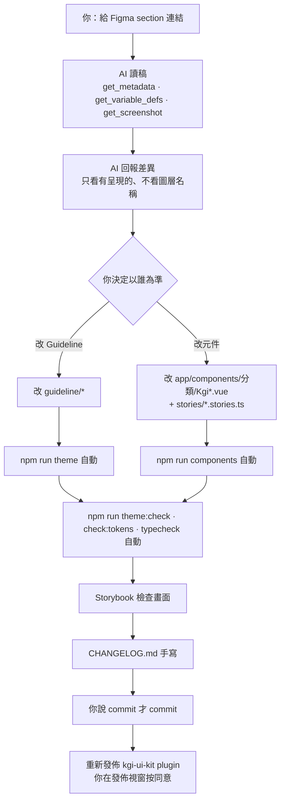
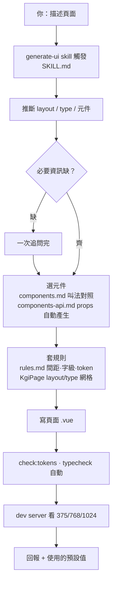
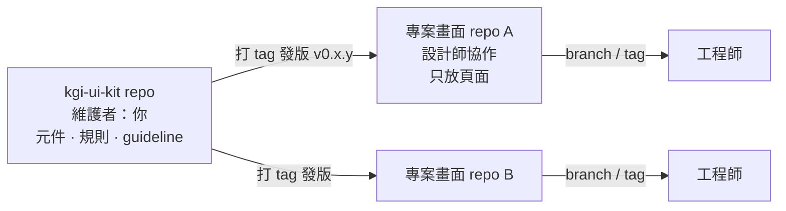
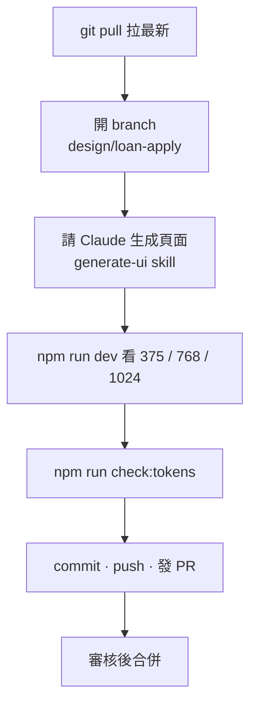

# 工作流盤點（2026-11-20）

這份是盤點，不是規則。規則仍以 `guideline/`、`CLAUDE.md`、generate-ui skill 為準。
**`guideline/` 不在精簡範圍內**，只有你說要更新時才會動。

---

## 1. 補 Foundation / 元件（從 Figma MCP）



| 步驟 | 用到 | 自動？ |
|---|---|---|
| 讀稿 | Figma MCP：`get_metadata`、`get_variable_defs`、`get_screenshot`（實例文字讀不到時用截圖） | AI 手動 |
| 流程與規則 | **sync-figma skill**（`plugins/kgi-ui-kit/skills/sync-figma/SKILL.md`）；讀稿方式照 `rules.md` 的「Figma 讀稿」 | — |
| 回報差異 → 決定 | 你 | 人 |
| 改 Guideline | `guideline/*.css`、`guideline/**/*.md` | 人同意後 AI 改 |
| 改元件 | `app/components/<分類>/Kgi*.vue`、`app/kgi.ts`、`stories/` | AI 手動 |
| 產生 | `npm run theme`、`npm run components` | **自動** |
| 檢查 | `npm run theme:check`、`npm run check:tokens`、`npm run typecheck`、`npm run build` | **自動** |
| 記錄 | `CHANGELOG.md`（Guideline 改動記在「規範」）、`CONFLICTS.md` | 手寫 |
| 上線 skill | `PublishPlugin`（plugins/kgi-ui-kit） | 手動 + 你同意 |

---

## 2. AI 讀 UI kit 生成畫面



AI 實際會讀的檔案（依順序）：

| 檔案 | 內容 | 維護方式 |
|---|---|---|
| `plugins/kgi-ui-kit/skills/generate-ui/SKILL.md` | 流程、推斷規則、必問、預設、追問規則、RWD | 手寫 |
| `…/components.md` | 叫法 → 元件、選用規則、kit 還沒有的元件 | 手寫 |
| `…/components-api.md` | 每個元件的 props / v-model / 事件 / slot / 說明 / 分類 | **自動**（`npm run components`） |
| `…/rules.md` | 間距表、字級、token 對照 | 手寫（與 CLAUDE.md 重複，見 §4） |
| `…/page-spec.md` | 頁面描述範本 | 手寫 |
| `CLAUDE.md` | 在 kit repo 裡工作時才會載入 | 手寫 |

注意：**線上 plugin 只帶 `plugins/kgi-ui-kit/` 這包**，不會帶 `CLAUDE.md`、`guideline/`、元件原始碼。在別的專案用時，AI 只看得到上表前五個檔案 + 該專案 `node_modules` 裡的 kit（若有安裝）。

---

## 3. 自動化清單

| 指令 | 讀 | 產生 | 何時跑 |
|---|---|---|---|
| `npm run theme` → `scripts/build-theme.mjs` | `guideline/*.css` | `tailwind.guideline.preset.ts`（Tailwind 只剩 Guideline token）、`app/assets/css/guideline-hover.css`（HSB 規則算 hover 色） | 改 guideline 後；`npm run build` 會先跑 |
| `npm run theme` → `scripts/build-typography.mjs` | `guideline/kgi-typography.css` | `app/assets/css/typography.css`（`.t-*` / `.n-*`、Web/mWeb 響應變數、iOS/Android 字重） | 同上 |
| `npm run components` → `scripts/build-components.mjs` | `app/components/**/Kgi*.vue`、`stories/**/*.stories.ts` 的 title | `components.json`、`components-api.md`；**檢查**元件資料夾 = Storybook 分類 | 改元件或 story 後 |
| `npm run check:tokens` → `scripts/check-tokens.mjs` | `app/`（`--built` 讀 build 後 CSS） | 報告：寫死的色碼、px、Tailwind 預設字級 class | 每次改完 |
| `npm run theme:check` | 上面三個產生器的 `--check` | 產物不是最新就失敗 | CI / commit 前 |
| Storybook（自動部分） | `guideline/`、`CHANGELOG.md`、元件原始碼 | Color / Typography / Spacing 頁直接讀 Guideline 數值；props 表（vue-component-meta）；Changelog 頁 | `npm run storybook` |

**不是自動的**：Figma 讀稿與比對、差異決策、`CLAUDE.md`、`rules.md`、`components.md`、`SKILL.md`、`page-spec.md`、`CONFLICTS.md`、`CHANGELOG.md`、story 檔、plugin 發佈、commit。

---

## 4. 重複盤點（不含 guideline）

> **2026-11-20 已整理**：使用規範只剩 `plugins/kgi-ui-kit/skills/generate-ui/rules.md` 一份（已補色彩用法、Figma 讀稿）。`CLAUDE.md` 用 `@` 載入它，`SKILL.md` 指向它，Storybook › Foundations › Rules 直接顯示它；`CONFLICTS.md` §G 改指向 CHANGELOG。`npm run theme:check` 會跑 `scripts/check-rules.mjs` 擋重抄，並比對間距、圓角、陰影清單與 `guideline/`。下表是整理前的狀態，留作紀錄；Grid System story 與 Typography 頁的說明文字仍有少量重複（給人看的範例說明）。

數字 = 該主題在檔案中出現次數（`scratchpad/dup-matrix.py` 掃描）。

| 主題 | 出現在 | 建議 |
|---|---|---|
| token ↔ class 對照、`p-16` = 16px | CLAUDE、CONFLICTS、rules、Storybook Overview | 規則只留一份（`docs/rules/tokens.md`），其他連過去 |
| 可用間距值清單 | CLAUDE、rules | 同上；數值可由 build-theme 產生 |
| 字級層級用途 | CLAUDE、rules | 合併成一份 |
| 間距表（頁首→內容…） | CLAUDE、SKILL、rules（+ guideline 原檔） | 規則檔只寫「見 guideline/Spacing」+ 對應 class，不重抄數值 |
| flow / browse 區塊間距 24/32 | CLAUDE、CHANGELOG、SKILL ×2、rules、Storybook 4 頁 | 數值放 `KgiPage` 與 rules 一處，其他只講名稱 |
| 填寫型最寬 570 | CLAUDE ×3、CHANGELOG ×3、rules、Grid story ×6 | 已有 token `--content-form`，文件改寫 token 名 |
| 字型只設一次 | CLAUDE ×2、SKILL、rules、Typography ×2 | 合併 |
| Guideline 修改紀錄 | CONFLICTS §G、CHANGELOG「規範」 | 已解決的只記在 CHANGELOG；CONFLICTS 只留**未解決**與命名決策 |
| Reka UI 說明 | CLAUDE、README、CONFLICTS、CHANGELOG、SKILL | 可接受（各自讀者不同），不急 |

**反過來：只出現一次、但 AI 生成時需要的**

| 規則 | 現在只在 | 風險 |
|---|---|---|
| 色彩用法（交易狀態 A/B、對比） | `stories/foundations/color-data.ts`（Storybook） | generate-ui 不會讀 Storybook → 生成時可能用錯色 |
| Figma 讀稿原則（只看連結 section、不看隱藏圖層、用套用值） | generate-ui `SKILL.md`、你的個人 memory | 別人或新 session 做 Foundation 同步時讀不到 |

---

## 5. 建議

1. **規則單一來源**：`docs/rules/*.md`（tokens、spacing、typography、color-usage、grid、figma-reading）。`CLAUDE.md` 用 `@docs/rules/…` 引入；`npm run components` 順便把它們複製進 `plugins/kgi-ui-kit/skills/generate-ui/`，加 `--check`。這樣 plugin 仍可單獨上線，但不會有手抄的第二份。
2. **色彩用法搬進規則**（上表第一列）——目前最大的遺漏。
3. **保護 guideline**：`.claude/settings.json` 對 `guideline/**` 設 `ask`（不是 `deny`，你說要改時仍可改），每次改都會跳確認。
4. **Figma 同步也做成 skill**（例如 `kgi-figma-sync`）：把讀稿規則、回報格式、改完要跑的指令固定下來，不靠個人 memory。
5. **plugin 版本**：線上是 0.1.0，本地已改過（components-api、RWD）。每次發佈前 bump `plugin.json` version，並在 CHANGELOG 記一行。
6. **commit 前檢查**：git pre-commit 跑 `theme:check` + `check:tokens`。
7. **生成品質回歸測試**：3–5 份固定的頁面描述（填寫型、閱讀型、列表型），改 skill 或規則後重跑，看追問與產出是否仍正確。
8. ~~小修：`scripts/check-tokens.mjs` 開頭註解仍寫 `src/`~~（已修）。

---

## 6. 用 git 共用 UI kit（多位設計師、多個專案）

### 兩種 repo



| repo | 放什麼 | 誰改 | 規則 |
|---|---|---|---|
| `kgi-ui-kit` | 元件、`rules.md`、`guideline/`、Storybook、腳本 | 你（維護者） | 主要分支只有你能直接改，其他人發 PR；每次發版改 `CHANGELOG.md`、`package.json` 的 `version`，打 tag（`v0.2.0`），有改 skill 就重新發佈 kgi-ui-kit plugin |
| 專案畫面 repo（一個專案一個） | `app/pages/` 的頁面 | 設計師 | **不改 kit**；kit 缺元件、規則不清楚 → 回報給你更新 kit。kit 版本寫在 `package.json`，要升級時統一改 |

為什麼分開：設計師在 kit repo 裡做畫面容易順手改到元件或規則，工程師那邊的 kit 就會和畫面對不上。

### 角色與權限

| 角色 | kit repo | 專案畫面 repo |
|---|---|---|
| 你（kit 維護者） | 讀寫 | 讀寫、審 PR |
| 設計師 | **讀**（`npm ci` 要下載 kit） | 讀寫（branch + PR） |
| 工程師 | **讀**（同上，沒有權限 `npm ci` 會失敗） | 讀 |

---

## 7. 每個新專案的建置步驟

### 7-1. 第一次使用這台電腦（每人一次）

1. 安裝 **Git**。
2. 安裝 **nvm**（Windows 用 nvm-windows），再用它安裝 **Node.js 22**（`nvm install 22`）。不要用 `npm install -g` 裝全域套件。
3. 安裝 **VS Code** + 擴充套件「Vue - Official」。
4. 安裝 **Claude Code**，用公司帳號登入；從組織 plugin 庫安裝 **kgi-ui-kit**（裡面有 generate-ui：生成介面；sync-figma：從 Figma 補充 kit）。
5. 只有要同步 Figma 的人：在 Claude Code 用 `/mcp` 連上 Figma 並登入。

### 7-2. 開新專案（你做，每個專案一次）

在公司 Git 建立 repo（例如 `<子公司>-<專案>-screens`），放入下面 5 個檔案後 push：

`package.json`（kit 用 git 網址 + tag 鎖版本）
```json
{
  "name": "<子公司>-<專案>-screens",
  "private": true,
  "type": "module",
  "scripts": {
    "dev": "nuxt dev",
    "build": "nuxt build",
    "postinstall": "nuxt prepare",
    "check:tokens": "node node_modules/@kgi/ui-kit/scripts/check-tokens.mjs ."
  },
  "dependencies": {
    "@kgi/ui-kit": "git+https://<公司 Git>/<群組>/kgi-ui-kit.git#v0.1.0",
    "nuxt": "~4.5.2",
    "vue": "~3.5.45"
  }
}
```

`nuxt.config.ts`
```ts
export default defineNuxtConfig({ extends: ['@kgi/ui-kit'] })
```

`.nvmrc`：一行 `22`

`.gitignore`
```
node_modules
.nuxt
.output
.data
.DS_Store
*.log
```

`CLAUDE.md`（讓 Claude 讀到 kit 的規則；GitHub Copilot 不會讀這個檔，要另外的入口檔，目前未做）
```md
# <專案名稱> 畫面

用 @kgi/ui-kit 做前端畫面，交給工程師。頁面放 `app/pages/`，一頁一個檔案。
- 生成頁面用 generate-ui skill；沒有安裝時，照 `node_modules/@kgi/ui-kit/plugins/kgi-ui-kit/skills/generate-ui/SKILL.md` 的流程。
- **不要修改 `node_modules/@kgi/ui-kit/`**。kit 缺元件或規則不清楚時，在頁面標 TODO 並在回報裡列出，由 kit 維護者更新。
- 交付前跑 `npm run check:tokens`。

@node_modules/@kgi/ui-kit/plugins/kgi-ui-kit/skills/generate-ui/rules.md
```

接著在本機跑一次 `npm install`，**把產生的 `package-lock.json` 一起 commit**（之後大家用 `npm ci` 照它安裝，版本完全一致）。

### 7-3. 設計師加入專案（每人每個專案一次）

```bash
git clone <專案畫面 repo 網址>
cd <專案資料夾>
nvm use
npm ci
npm run dev
```

打開 http://localhost:3000 確認跑得起來。

### 7-4. 每次做畫面



- 不熟 git 可以直接跟 Claude 說：「拉最新的」「開一個分支做借款申請」「commit 並推上去發 PR」「有衝突，幫我看」。
- **避免衝突**：先分好誰負責哪幾頁，一頁一個檔案。
- 只改 `app/pages/`（和必要的假資料檔），不改 kit。

### 7-5. 交給工程師

- 給**專案 repo 網址 + branch 或 tag**。kit 版本已寫在 `package.json`，工程師 `npm ci` 後拿到同一版 kit 與規則。
- 工程師要有 kit repo 的讀取權限。
- 規則與元件說明：`node_modules/@kgi/ui-kit/plugins/kgi-ui-kit/skills/generate-ui/rules.md`；建議另外把 kit 的 Storybook（`npm run build-storybook` → `storybook-static/`）部署成內部網站，給工程師、PM 查。
- 頁面裡的文案、數值是假資料（標 `// TODO: 待替換文案`）。

### 7-6. kit 更新時

1. 你在 kit repo 改完 → 更新 `CHANGELOG.md`、`version` → 打 tag → push；有改 skill 就重新發佈 plugin。
2. 專案要升級時，把專案 `package.json` 的 `#v0.1.0` 改成新 tag → `npm install` → 看 CHANGELOG 的 ⚠️ 不相容變更、檢查畫面 → commit `package.json` 與 `package-lock.json`。
3. 專案不升級就維持舊版，不會被突然改壞。

---

## 8. 套件與資安守則

| 要做 | 不要做 |
|---|---|
| 一個專案一個資料夾，各自 `node_modules` | 全域安裝（`npm install -g`）；要執行工具用 `npx` |
| 用 nvm 切 Node 版本，專案放 `.nvmrc` | 同一個專案混用 npm / yarn / pnpm |
| 平常用 `npm ci`（照 `package-lock.json` 安裝，不改鎖定檔） | 刪掉或不 commit `package-lock.json` |
| 新增套件先問 kit 維護者或 IT | 隨意 `npm install <新套件>` |
| 定期跑 `npm audit`，結果給 IT 判斷 | 看到漏洞就 `npm audit fix --force`（會升大版本，偏離規定的技術版本） |
| 用 git clone 取得 kit / 專案 | 複製整包資料夾（會帶到 `node_modules`、`.nuxt`、`.output`、`storybook-static`，換電腦可能壞掉） |

- 安裝時會執行腳本的套件只有 3 個：`@kgi/ui-kit`（`nuxt prepare`）、`esbuild`（下載對應系統的編譯工具）、`vue-demi`。較新的 npm 會提示「install scripts not yet covered by allowScripts」，這 3 個是預期內的。
- 2026-11-20 實測：用 `git+file://…#<commit>` 安裝 kit 的測試專案，`npm install` 47 秒、737 個套件；`nuxt build` 成功，專案頁面上的 Guideline class、`KgiPage` 網格、icon 都正常產出；`check:tokens <專案路徑>` 能抓到專案頁面裡的寫死數值。
